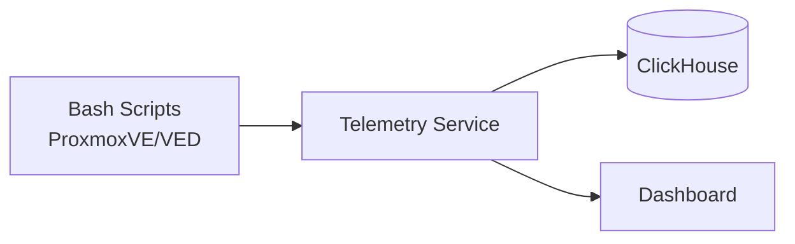

<p align="center">
  
</p>

# services

Backend services for [ProxmoxVE](https://github.com/community-scripts/ProxmoxVE) and
[DevScripts](https://github.com/community-scripts/DevScripts), in one Go module:

| Service | Path | What it does |
| --- | --- | --- |
| **Telemetry** | `cmd/telemetry` | Collects anonymous install telemetry from the bash scripts and serves the public dashboard |
| **Discord bot** | `cmd/discord` | Turns a Discord support thread into a GitHub issue on a moderator's command |

Each builds its own binary and its own image; they share nothing but the module.

## Brand assets

The approved CS Amber mark is shared by all four telemetry dashboard views and
their favicons. The editable [SVG master](cmd/telemetry/public/static/img/logo.svg)
and its 512px [PNG avatar](cmd/telemetry/public/static/img/logo.png) are embedded
in the telemetry binary. Brand images bypass the monochrome SVG icon inliner
to preserve the approved colors and mask. Versioned asset URLs invalidate old
browser caches after deployment.

```bash
go build ./cmd/telemetry
go build ./cmd/discord
go test ./...
```

---

## Telemetry — overview

This service acts as a telemetry ingestion layer between the bash installation scripts and a ClickHouse backend. When users run scripts from the ProxmoxVE/DevScripts repositories, optional anonymous usage data is sent here for aggregation and analysis.

**What gets collected:**

- Script name and installation status (success/failed)
- Container/VM type and resource allocation (CPU, RAM, disk)
- OS type and version
- Proxmox VE version
- Anonymous session ID (randomly generated UUID)

**What is NOT collected:**

- IP addresses (not logged, not stored)
- Hostnames or domain names
- User credentials or personal information
- Hardware identifiers (MAC addresses, serial numbers)
- Network configuration or internal IPs
- Any data that could identify a person or system

**What this enables:**

- Understanding which scripts are most popular
- Identifying scripts with high failure rates
- Tracking resource allocation trends
- Improving script quality based on real-world data

## Features

- **Telemetry Ingestion** - Receives and validates telemetry data from bash scripts
- **ClickHouse Storage** - Stores and aggregates records in ClickHouse
- **Rate Limiting** - Configurable per-IP rate limiting to prevent abuse
- **Caching** - In-memory or Redis-backed caching support
- **Email Alerts** - SMTP-based alerts when failure rates exceed thresholds
- **Dashboard** - Built-in HTML dashboard for telemetry visualization

## Architecture



## Dashboard

The built-in dashboard is publicly available at `https://telemetry.community-scripts.org/` and is served from `/` (with `/dashboard` kept as a compatibility alias). It provides real-time analytics:

- **Installation Statistics** - Total installs, success/failure rates
- **Top Applications** - Most installed scripts with counts
- **Failure Analysis** - Scripts with highest failure rates (min. 10 installs)
- **Resource Trends** - CPU, RAM, disk allocation over time
- **OS Distribution** - Popular operating systems
- **Proxmox Versions** - PVE version distribution

**Dashboard Features:**

- Automatic cache warmup (every 4 minutes)
- Configurable time range (7, 30, 90, 365 days)
- Shows actual total count vs. analyzed sample size
- Loading indicator during data fetch

## Project Structure

```
cmd/telemetry/
  service.go        # HTTP handlers, rate limiting
  clickhouse.go     # Storage and aggregation queries
  cache.go          # In-memory and Redis caching
  alerts.go         # SMTP alert system
  dashboard.go      # Shared dashboard data types
  public/           # Dashboard templates and assets (go:embed)
cmd/discord/
  main.go           # Session, command registration, interaction handling
  thread.go         # Thread reader and issue renderer
  store.go          # PocketBase client
  github.go         # GitHub App auth, issues, comments, locks
  webhook.go        # HTTP listener for GitHub webhooks
  lifecycle.go      # Testing thread lifecycle driven by issue events
  script.go         # Script resolution from the issue form
  sync.go           # Message mirroring in both directions, /sync command
  reconcile.go      # Startup pass: rows and mirroring for pre-existing threads
Dockerfile          # Telemetry image
Dockerfile.discord  # Discord bot image
entrypoint.sh       # Telemetry container entrypoint
go.mod              # Go module definition
```

`public/` and `testdata/` live beside the telemetry sources rather than at the
repository root because `//go:embed` cannot reach into a parent directory.

## Related Projects

- [ProxmoxVE](https://github.com/community-scripts/ProxmoxVE) - Proxmox VE Helper Scripts
- [DevScripts](https://github.com/community-scripts/DevScripts) - Scripts in development and testing

## API Endpoints

| Endpoint          | Method | Description                              |
| ----------------- | ------ | ---------------------------------------- |
| `/`               | GET    | HTML dashboard UI                        |
| `/dashboard`      | GET    | Compatibility alias for the dashboard UI |
| `/telemetry`      | POST   | Receive telemetry data from scripts      |
| `/healthz`        | GET    | Health check endpoint                    |
| `/api/dashboard`  | GET    | Dashboard data as JSON                   |
| `/api/records`    | GET    | Paginated installation log data          |
| `/api/scripts`    | GET    | Script analysis data                     |
| `/api/exit-codes` | GET    | Exit-code reference data                 |
| `/metrics`        | GET    | Prometheus-style metrics output          |

Operational endpoints also exist for alerts and cleanup workflows, including `/api/alerts`, `/api/cleanup/status`, and `POST /api/cleanup/run`.

## Privacy & Compliance

This service is designed with privacy in mind and is **GDPR/DSGVO compliant**:

- ✅ **No personal data** - Only anonymous technical metrics are collected
- ✅ **No IP logging** - Request logging is disabled by default, IPs are never stored
- ✅ **Transparent** - All collected fields are documented and the code is open source
- ✅ **No tracking** - Session IDs are randomly generated and cannot be linked to users
- ✅ **No third parties** - Data is only stored in our self-hosted PocketBase instance

For full details, see:

- **[Privacy & Telemetry Documentation](docs/PRIVACY.md)** — What we collect, how, and why
- **[Records of Processing Activities (ROPA)](docs/ROPA.md)** — GDPR Art. 30
- **[Technical & Organizational Measures (TOMS)](docs/TOMS.md)** — GDPR Art. 32

---

## Discord bot

Links Discord threads to GitHub issues in both directions:

- **Support threads → issues.** Right-click any message in a thread or forum post →
  **Apps → Create GitHub Issue**. The thread is copied across verbatim — authors,
  timestamps, message order — so nothing is summarised away or has to be retyped.
  The reply is ephemeral; the issue link is posted once into the thread.
- **Testing thread lifecycle.** When a DevScripts issue gets the `Ready For Testing`
  label, the bot opens a forum post with the test command and keeps it in step with
  the issue until the issue closes.
- **Live mirroring.** A thread with mirroring on posts its messages to the issue, and
  the issue's comments come back into the thread.

### Support threads

- **Moderator only.** The command is hidden from members without *Manage Messages*, but
  that is cosmetic — the binding check runs server-side against
  `discord_config.allowed_role_ids`.
- **One issue per thread**, enforced by a unique index on `discord_issues.thread_id`.
  Running it again on the same thread refreshes that issue's body instead of
  opening a second one, so a conversation that carried on after the export ends
  up in the issue. Title and labels are left alone, since both may have been
  corrected on GitHub.
- **Images are linked, not rehosted.** Discord attachment URLs are signed and expire
  after roughly 24 hours, so every attachment also carries a permanent link to its
  message, and the issue header links the thread.
- **Long threads are truncated** below GitHub's 65536-character body limit, with a
  pointer back to Discord.

A modal opens first with five optional fields -- script name, OS and version,
Proxmox version, a short summary, and notes. Whatever the helper fills in becomes
a small table above the thread; blanks are left out. Five is Discord's limit for
a modal, so the fields cover what a thread rarely states in a structured way, not
the whole bug template.

Images are copied into the `issue_attachments` collection and embedded from
there, because Discord's attachment links are signed and expire after about a
day. Other files stay as links, so logs and archives do not fill the database.

### Testing threads

The `issues` webhook of the dev repository (`discord_config.dev_repo`) drives the
lifecycle:

| Issue event | Thread |
| --- | --- |
| `Ready For Testing` added | Forum post "Wanted Tester for …" named after the issue in `testing_channel_id`, tagged *Testing*, with the install command, default credentials and notes from the script's json. The same text plus the thread link is commented on the issue. A second time, the existing post is reopened with a "testing resumed" notice. |
| `Ready For Testing` removed | "Testing paused" notice with the last human comment, tag *On Hold*. Skipped when `deferred` or a migration label is on the issue, those modes own the message. |
| `deferred` added | Notice, thread locked and archived, tag *Deferred*; the issue is commented and locked. |
| `Started Migration To ProxmoxVE` added | Migration notice with the PR, thread locked and archived, tag *Migrating*, mirroring off. |
| Issue closed | Thread deleted. |

The script path comes from the issue form (*Name of the Script*, *Script Type*,
*Script path*, *Where does it run?*) and is checked on `main` before anything is
posted; a missing file gets a warning comment instead of a thread. Label changes
made with a workflow's `GITHUB_TOKEN` reach the bot too, since App webhooks are
not subject to the no-recursion rule for Actions.

Threads the former GitHub Action created get their row at startup: the bot walks
the open issues of `dev_repo`, follows the `<!-- discord-thread-id -->` marker in
the comments, records the thread and turns mirroring on with a pinned notice.
Nothing has to be run by hand.

### Mirroring

- Testing threads are always mirrored while they are open for testing; the opening
  post says so and `/sync` refuses on them. A support thread is mirrored from the
  moment **Create GitHub Issue** links it, with a pinned notice; a moderator can
  stop that with `/sync off` and resume with `/sync on`.
- Discord messages are collected per thread for `SYNC_BATCH_SECONDS` and posted as
  one issue comment, one quoted block per message with author and time. Images go
  through `issue_attachments`; other files stay links. Editing or deleting a
  message rebuilds that comment; deleting the last one deletes the comment.
- Issue comments are posted into the thread as `**login** on GitHub`, split at
  2000 characters, HTML comments stripped, mentions never resolved. Edits and
  deletions follow.
- Nothing loops: the bot ignores its own Discord messages and comments made by its
  own GitHub App. Redelivered webhooks are dropped through the `discord_sync` rows.
- While a thread is mirrored, **Create GitHub Issue** refuses to refresh the issue
  body, since the comments already carry the conversation.

### Setup

1. *Discord application* — enable the **Message Content** intent, invite with the `bot`
   and `applications.commands` scopes, grant **Read Message History**, **Send
   Messages**, **Manage Messages** and **Manage Threads** in the support and
   testing channels. Commands register themselves per guild at startup.
2. *GitHub App* — **Issues: Read and write** on the dev and the main repository.
   Subscribe to the **Issues** and **Issue comment** events, point the webhook at
   `https://<bot>/webhooks/github` and set a secret. Note app id, installation id
   and private key.
3. *PocketBase* — import `cmd/discord/pocketbase-schema.json` under *Settings → Import
   collections* (existing collections are updated in place), then add one
   `discord_config` record:

   | Field | Type | Example |
   | --- | --- | --- |
   | `guild_id` | text | `000000000000000001` |
   | `allowed_role_ids` | json | `["000000000000000002"]` |
   | `target_repo` | text | `community-scripts/ProxmoxVE` |
   | `default_labels` | json | `["bug"]` |
   | `enabled` | bool | `true` |
   | `dev_repo` | text | `community-scripts/DevScripts` |
   | `testing_channel_id` | text | `000000000000000003` |

   Snowflakes are `text` on purpose — they are 64-bit and JavaScript clients would
   silently mangle them past 2^53 as numbers. The schema ships with API rules that
   let any authenticated account read `discord_config` and read and write
   `discord_issues` and `discord_sync`, so the bot and the website can use normal
   accounts instead of the superuser.

### Environment

| Variable | Required | Meaning |
| --- | --- | --- |
| `DISCORD_TOKEN` | yes | bot token |
| `GITHUB_APP_ID`, `GITHUB_APP_INSTALLATION_ID`, `GITHUB_APP_PRIVATE_KEY` | yes | GitHub App; the key may be PEM or base64, in any mangling an env field inflicts |
| `GITHUB_WEBHOOK_SECRET` | for lifecycle and mirroring | without it the webhook route is not served and only the context-menu export works |
| `POCKETBASE_URL`, `POCKETBASE_ADMIN_EMAIL`, `POCKETBASE_ADMIN_PASSWORD` | yes | PocketBase |
| `POCKETBASE_AUTH_COLLECTION` | no | authenticate as a record of this collection instead of the superuser |
| `HTTP_ADDR` | no | listen address, default `:8080` |
| `SYNC_BATCH_SECONDS` | no | how long Discord messages are collected before one comment is posted, default `60` |
| `MAX_THREAD_MESSAGES` | no | cap for the one-shot export, default `500` |

## License

MIT License - see [LICENSE](LICENSE) file.
